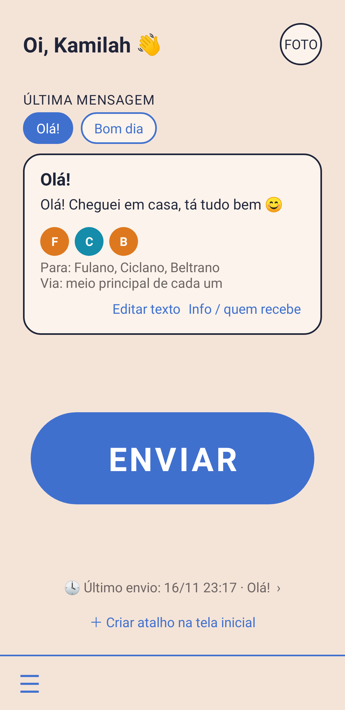
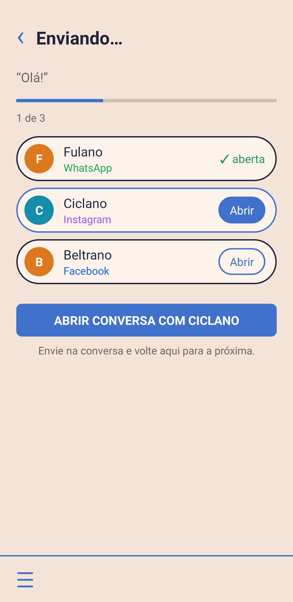
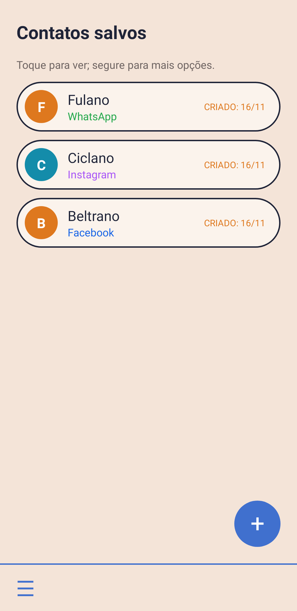
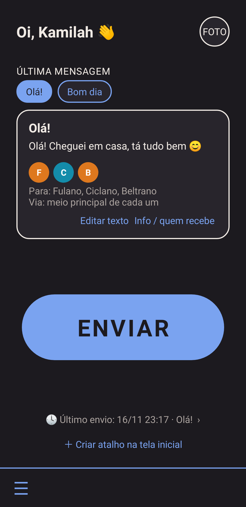

# Chegou

**Sua mensagem, para quem você quiser, com um toque.**

Chegou é um aplicativo Android que guarda mensagens prontas (com ou sem foto/vídeo) e envia para as
pessoas escolhidas, cada uma pela sua rede preferida, ao toque de um botão.

<p>
  
  
  
  
  
</p>

## Baixar

**[⬇ Baixar o Chegou.apk](../../releases/latest/download/Chegou.apk)** (Android 6.0 ou mais novo)

Abra o arquivo no celular e permita a instalação "desta fonte". Como o app não vem da Play Store,
o Play Protect pode mostrar um aviso: toque em *Instalar mesmo assim*.

## O que ele faz

- **Um toque para enviar**: o botão ENVIAR do Início, ou o atalho (widget) na tela inicial do celular.
- **Mensagens salvas** com nome, texto de até 1000 caracteres e mídia opcional (até 10 MB).
- **`{nome}` no texto** vira o primeiro nome de cada pessoa: "Oi {nome}!" → "Oi Ana!".
- **Contatos** com o meio de comunicação principal de cada um.
- **Acompanhamento do envio**: cada pessoa aparece com seu estado (enviado, aberta, falhou e por quê).
- **Histórico** dos últimos envios.
- Tema claro e escuro, fonte maior, alto contraste, português e inglês.
- Tudo fica **só no celular**: não há servidor, cadastro online nem coleta de dados.

### Como cada rede envia

| Rede | Como funciona |
| --- | --- |
| SMS | Sozinho, sem nenhum toque extra (com mídia, abre o app de mensagens pronto) |
| Telegram | Sozinho, por um bot seu (configuração única em *Contas vinculadas*) |
| WhatsApp | Abre a conversa com a mensagem pronta; é só tocar em enviar |
| Instagram, Facebook, X, Snapchat | Abre a conversa e deixa a mensagem copiada para colar |

WhatsApp, Instagram, Facebook, X e Snapchat não permitem que outros aplicativos enviem mensagens
no lugar da pessoa, por isso nesses casos o Chegou deixa tudo pronto e o envio final é seu.

## Como foi feito

O projeto nasceu de [rascunhos à mão](docs/telas) de 19 telas e foi escrito em **Java puro**, usando
só o que já vem no Android (sem bibliotecas externas). O instalador final tem menos de 100 KB.

```
src/com/mensagemrapida/
  MainActivity.java   navegação, menu lateral, avisos
  Tela*.java          uma classe por tela dos rascunhos
  Envio.java          o que acontece ao tocar em ENVIAR
  Dados.java          tudo o que é guardado no celular
  Ui.java             cores, temas e peças de interface
testes/               testes automáticos (Robolectric) que usam o app do começo ao fim
```

### Compilar

Em um Ubuntu 24.04:

```bash
sudo apt-get install android-sdk-platform-23 android-sdk-build-tools apksigner dalvik-exchange
./build.sh          # gera app/Chegou.apk
```

Na primeira vez o script cria uma chave de assinatura (`chave.jks`). Guarde esse arquivo em lugar
seguro e não publique: o Android só aceita atualizar um app se a nova versão for assinada pela mesma chave.

### Testar

```bash
./build.sh && cd testes && gradle test
```

Os testes abrem o app num Android simulado, criam conta, mensagens e contatos, enviam, excluem,
trocam tema e idioma, e também geram as capturas de tela de `docs/telas`.
